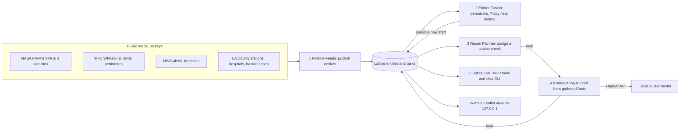

# kodros-lattice-wildfire

Five wildfire apps built on Anduril's Lattice SDK. They turn free public fire data for Los Angeles County into a shared map of tracks and assets, flag possible new fire starts, plan which station checks each one, and write short intel briefs with a local AI model. You can ask questions about the picture from a chat client over MCP.

Written by a firefighter-paramedic as part of [Kodros](https://kodros.ai), using only public data and a self-hosted model.

## How it works



Every number, name and direction in a brief is checked against the facts the analyst gathered. A line that fails the check is replaced with the raw facts. Steady industrial heat (refineries) is held back using 7 days of history from all three satellites. A local contract harness stands in for a Lattice server and validates every request body against Anduril's published REST OpenAPI spec.

## Stack

Python 3.12, `anduril-lattice-sdk` 5.4.0, httpx, jsonschema, MCP 2.x SDK, Leaflet, uv, pytest, ruff, Docker. Model calls go to a self-hosted OpenAI-compatible endpoint (`KODROS_LLM_URL`). No hosted models.

## Run

```bash
uv sync --extra talk --group dev
mkdir -p vendor && curl -fsSL -o vendor/lattice-rest-openapi.json https://developer.anduril.com/openapi/rest.json
uv run pytest -q                                   # captured fixtures plus local harness
uv run lw-run --with-harness 8765 &                # harness, feeds, fusion, analyst, planner
export LATTICE_BASE_URL=http://127.0.0.1:8765 ENVIRONMENT_TOKEN=harness-token
uv run lw-map --port 8770 &                        # open http://127.0.0.1:8770/
uv run lw-talk ask "What is burning in LA County right now?"
```

The OpenAPI spec is Anduril's and is fetched, not shipped here. For a real Lattice Sandbox, copy `.env.example` to `.env`, set `LATTICE_ENDPOINT`, `ENVIRONMENT_TOKEN` and `SANDBOXES_TOKEN`, and unset `LATTICE_BASE_URL`. Per-app docs: [docs/apps/](docs/apps/). Entity vocabulary and data flow: [docs/CONTRACT.md](docs/CONTRACT.md).

## Status and limits

- Verified 2026-11-09 on the local harness with real public data: full chain from feeds to an analyst brief, and `lw-talk ask` answering with entity ids. Analyst eval: 10 of 10 briefs passed the format check over 10 LA County points, median 21.5 s ([evals/analyst/results-20261109.md](evals/analyst/results-20261109.md)).
- Not yet run against a live Lattice Sandbox. No sandbox credentials existed at the time.
- Test fixtures are captured public agency data (NWS, NASA, NIFC, CAL FIRE, LA County). The spec has changed since capture, so a freshly fetched copy can fail a test.
- Research and demo software. It is not a dispatch or warning system. Use official sources for any real fire.

## License

MIT for the code in this repo ([LICENSE](LICENSE)). The Lattice SDK and spec are Anduril's and follow Anduril's SDK license. Not affiliated with or endorsed by Anduril.
