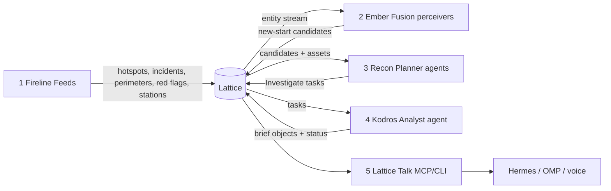

# lattice-wildfire build contract

Five wildfire applications on Anduril's Lattice SDK (`anduril-lattice-sdk` 5.4.0, Python), one package.
Default area of interest is Los Angeles County. Local-first: the Kodros cluster LLM
(`http://127.0.0.1:8080/v1`, model `cluster-current`) is the only model used.

## Sources this combines

- Anduril GitHub: `lattice-sdk-python`, `lattice-sdk-ai` (official integration skills),
  `sample-app-ais-integration-rest` (entity publisher pattern), `sample-app-auto-reconnaissance`
  (arbiter/tasker/simulated asset pattern), `sample-app-entity-visualizer`, `sample-app-thumbnail` (Objects).
- Our GitHub/local: free keyless fire feeds, LA County eGIS layers, the Kodros cluster,
  Hermes/OMP MCP tooling, and our own fire study and protocol reference apps (LA County context).
- REST contract: `vendor/lattice-rest-openapi.json` fetched 2026-11-09 from
  `https://developer.anduril.com/openapi/rest.json`.

## Layout (single package, one owner per directory)

| Path | App | Owner |
|---|---|---|
| `src/lattice_wildfire/core/` | shared config, client, entity helpers, geo, http, layers, llm | wave 1 |
| `src/lattice_wildfire/harness/` | local Lattice REST contract server for offline tests | wave 1 |
| `src/lattice_wildfire/feeds/` | App 1 **Fireline Feeds**: public feeds -> Lattice entities | lane 1 |
| `src/lattice_wildfire/fusion/` | App 2 **Ember Fusion**: multi-agent perception | lane 2 |
| `src/lattice_wildfire/planner/` | App 3 **Recon Planner**: multi-agent planning + tasking | lane 3 |
| `src/lattice_wildfire/analyst/` | App 4 **Kodros Analyst**: taskable agent, intel briefs | lane 4 |
| `src/lattice_wildfire/talk/` | App 5 **Lattice Talk**: MCP server + chat CLI | lane 5 |
| `tests/test_<pkg>.py` | per-package tests | same owner |
| `docs/apps/<pkg>.md` | per-app doc | same owner |

Lanes edit only their own directory, test file and doc. `pyproject.toml` console scripts and
dependencies are owned by the integrator; a lane that needs a dependency names it in its final report.

## Rules every lane follows

1. Do not guess Lattice enum literals or field names. Introspect the installed SDK
   (`uv run python -c "import anduril; print(anduril.MilView.model_fields['environment'].annotation)"`).
   Docs lag the SDK: `tasks.update_task_status` takes `new_status=TaskStatus(...)`, not `status=`.
2. Credentials come only from the environment via `core.config.LatticeSettings.from_env()`. Never log them.
3. Every published entity carries: deterministic `entity_id`, `is_live=True`, future `expiry_time`
   (< 30 days), `provenance(integration_name, data_type, source_update_time)`, non-empty `aliases.name`,
   `data_classification` UNCLASSIFIED, `symbology` SIDC for tracks/assets.
4. No fabricated data. Live feeds are fetched for real; test fixtures are real captured responses
   saved under `tests/fixtures/<pkg>/` with the capture date in the filename.
5. Prove behavior against the contract harness: publish or task, then read back in a separate call.
   A live Lattice Sandbox round-trip needs `LATTICE_ENDPOINT`, `ENVIRONMENT_TOKEN`, `SANDBOXES_TOKEN`
   (not present on this host 2026-11-09); report it as unverified, never claim it.

## Shared entity vocabulary (provenance.data_type -> shape)

| data_type | Template | platform_type | entity_id |
|---|---|---|---|
| `firms-viirs-hotspot` | TEMPLATE_TRACK, ENVIRONMENT_LAND, DISPOSITION_UNKNOWN | `Wildfire Hotspot` | `lw-firms-{satellite}-{acq_date}{acq_time}-{lat:.4f}-{lon:.4f}` |
| `wfigs-incident` | TEMPLATE_TRACK, ENVIRONMENT_LAND, DISPOSITION_UNKNOWN | `Wildfire Incident` | `lw-wfigs-{IrwinID}` |
| `calfire-incident` | TEMPLATE_TRACK, ENVIRONMENT_LAND, DISPOSITION_UNKNOWN | `Wildfire Incident` | `lw-calfire-{UniqueId}` |
| `wfigs-perimeter` | TEMPLATE_GEO polygon | `Wildfire Perimeter` | `lw-perim-{IrwinID or OBJECTID}` |
| `nws-red-flag` | TEMPLATE_GEO polygon | `Red Flag Warning` | `lw-nws-{alert id hash}` |
| `lacofd-station` | TEMPLATE_ASSET, ENVIRONMENT_LAND, DISPOSITION_FRIENDLY | `Fire Station` | `lw-station-{station number}` |
| `ember-candidate` | TEMPLATE_TRACK, ENVIRONMENT_LAND, DISPOSITION_SUSPICIOUS | `New Start Candidate` | `lw-cand-{date}-{geohash7}` |
| `kodros-analyst` | TEMPLATE_ASSET, DISPOSITION_FRIENDLY, task_catalog Investigate | `AI Analyst` | `lw-analyst-{host}` |

All integration names are `lattice-wildfire-<pkg>`. Task type for investigation is
`type.googleapis.com/anduril.tasks.v2.Investigate` with `objective.entity_id` = target entity.
Analyst briefs are Objects at `lattice-wildfire/briefs/{task_id}.md` and `.json`.

## Data flow

