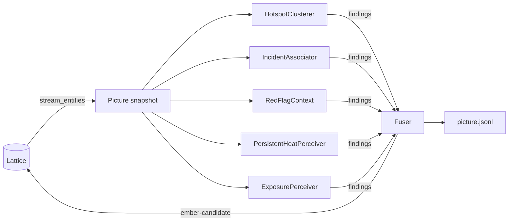

# App 2: Ember Fusion

Ember Fusion reads the wildfire picture out of Lattice and decides which satellite hotspot
clusters look like **new starts**: fires that no perimeter or incident already explains. It
publishes each one back as an `ember-candidate` track for Recon Planner (App 3) to task.

## Run

```bash
# one snapshot, one pass, then exit (cron-friendly)
uv run python -m lattice_wildfire.fusion --once
# continuous: live entity stream, a fusion pass every 60 s
uv run python -m lattice_wildfire.fusion --interval 60
# assess and record, publish nothing
uv run python -m lattice_wildfire.fusion --once --dry-run --json
```

| Flag | Default | Meaning |
|---|---|---|
| `--once` | off | `stream_entities(pre_existing_only=True)` snapshot, one pass, exit |
| `--threshold` | `0.4` | minimum score for an unassociated cluster to publish |
| `--interval` | `60` | seconds between passes in continuous mode |
| `--dry-run` | off | run every perceiver, write `picture.jsonl`, publish nothing |
| `--picture-out` | `$LW_STATE_DIR/fusion/picture.jsonl` | run record path (`LW_STATE_DIR` defaults to `~/.local/state/lattice-wildfire`) |
| `--json` | off | print the full run record (with `--once`) |

Credentials and AOI come from the environment (`core.config`): `LATTICE_BASE_URL` or
`LATTICE_ENDPOINT`, `ENVIRONMENT_TOKEN`, `SANDBOXES_TOKEN`, `LW_AOI_BBOX`. Exit codes: `0` ok,
`1` a candidate failed to publish, `2` configuration error.

## Pipeline



1. **Picture** (`picture.py`, pure). Entities are grouped by `provenance.data_type`:
   `firms-viirs-hotspot`, `wfigs-incident`, `calfire-incident`, `wfigs-perimeter`,
   `nws-red-flag`, `lacofd-station`. Entities that are not live or already expired are dropped
   and counted in `skipped`; our own `ember-candidate` tracks are never inputs. Hotspot fields
   follow the Fireline Feeds contract: `acquired`, `frp_mw`, `confidence`, `satellite` from the
   `key: value` description lines, falling back to `tracked.last_measurement_time`,
   `tracked.track_quality_wrapper` (1/2/3 = low/nominal/high) and `ontology.specific_type`.
   Hotspots are clustered once here (single linkage, 1500 m, `core.geo.cluster_points`) so
   every perceiver sees identical clusters. The snapshot itself also carries live
   `ember-candidate` tracks published by this integration (`app.live_candidates`); the picture
   ignores them, the retirement pass reads them.
2. **Perceivers** (`perceivers.py`) run on a thread pool, one thread each, over the same frozen
   snapshot. None reads another's output.
3. **Fuser** (`fuser.py`, pure, deterministic) combines findings into one score per cluster.
4. **Edge** (`app.py`) publishes candidates, retracts candidates that stopped qualifying, and
   appends one JSON line per run.

## Perceivers

| Perceiver | Reads | Emits |
|---|---|---|
| `HotspotClusterer` | clusters | `confidence` (max VIIRS confidence), `frp` (FRP sum, all satellites), `corroboration` (passes, pixels, satellites) |
| `IncidentAssociator` | clusters, perimeters, incidents | `associated` when any member or the centroid is inside a perimeter (holes excluded), or any member is within 3 km of an incident point |
| `RedFlagContext` | clusters, red flag polygons | `red_flag` when any member or the centroid is inside an unexpired warning polygon |
| `PersistentHeatPerceiver` | cluster centroid and members, FIRMS NOAA-20 + Suomi NPP + NOAA-21 7-day CSVs (merged) | `persistent_heat` when detections within 750 m of the centroid fall on ≥ 3 distinct `acq_date`s in the 7 days before the cluster's first detection (through its last) **and** the cluster is not growing (below); the cluster's own detections never count |
| `ExposurePerceiver` | cluster centroid, stations, hospitals, FHSZ | `proximity` (stations and hospitals within 5 km and 10 km, nearest of each), `fhsz` (`core.layers.fhsz_at`) |

Stations come from `lacofd-station` entities when Fireline Feeds published them, otherwise from
`core.layers.fire_stations(aoi)`. Hospitals always come from `core.layers.hospitals(aoi)`. A
failed FHSZ lookup is written into the evidence as a failure, never guessed. A failed facility
load fails the exposure perceiver only; its components then count as 0 and the evidence says so.

## Scoring

`score = Σ weight × component`, each component in 0..1, weights sum to 1.0, so the score is in
0..1. Weights live in `fuser.WEIGHTS`.

| Component | Weight | Value | Rationale |
|---|---|---|---|
| `confidence` | 0.25 | low 0.3, nominal 0.6, high 1.0 | VIIRS confidence is the sensor team's own false-alarm screen (sun glint, hot ground); it is the best single signal that a pixel is fire at all. |
| `frp` | 0.20 | `log10(1+FRP_sum) / log10(101)`, capped at 1 | Fire radiative power measures energy release. Log scale because FRP spans orders of magnitude; saturates at 100 MW, already a large, actively spreading fire. |
| `corroboration` | 0.15 | `0.7 × min(1, (passes−1)/2) + 0.3 × min(1, (pixels−1)/3)` | Detection on repeat overpasses rules out one-off artifacts; adjacent pixels in one pass add less, they can be one hot object. |
| `red_flag` | 0.20 | 1 inside an active Red Flag Warning | Red Flag weather (wind, low humidity) is when a small start becomes a major fire. As heavy as FRP on purpose: a weak detection under Red Flag deserves eyes. |
| `fhsz` | 0.12 | Very High 1.0, High 0.66, Moderate 0.33, else 0 | CAL FIRE hazard zones encode fuel, slope and fire history at the location. |
| `proximity` | 0.08 | 1 if any station or hospital within 5 km, 0.5 within 10 km | Proxy for people and structures nearby. Kept small: it raises consequence, not likelihood that the pixel is a fire. |

Worked examples (real 2026-11-09 NOAA-20 data):

- One nominal 1.73 MW pixel, nothing else: 0.15 + 0.044 = **0.19**, held at the 0.40 default.
- The same pixel inside a Red Flag Warning: **0.39**. Red Flag alone does not publish a lone
  weak pixel; one more pass or FHSZ High does.
- Three nominal passes over one Glendale spot (3.52 MW total) inside a Red Flag Warning:
  0.15 + 0.065 + 0.135 + 0.20 = **0.55**, `track_quality_wrapper` 8 if published. The real spot
  is held as a fixed heat source (detections on 6 of the prior 7 dates); the same detections
  moved to a site with no history publish.

**Associated clusters are never published.** A cluster explained by a perimeter or an incident
is a known fire (or a prescribed burn: the 2026-11-09 capture's Merced pixels sit 0.3 to 1.0 km
from the WFIGS "NORTH MERCED UNDERBURN" RX incident). Its score is still computed and recorded.

**Fixed heat sources are never published.** Refineries, landfill flares and plants show up in
FIRMS day after day. `PersistentHeatPerceiver` fetches the three real 7-day active-fire files
(NOAA-20 `noaa-20-viirs-c2`, Suomi NPP `suomi-npp-viirs-c2`, NOAA-21 `noaa-21-viirs-c2`) through
`core.http.fetch_text` with a 3 h cache each, and merges them with
`fusion.history.merged_history`. A stale cached copy is used and flagged `(stale cache)` in the
evidence.

A date is a date whichever satellite saw it: distinct `acq_date` values count across the union
(11-03 seen by both NOAA-20 and NOAA-21 is one date), and rows are de-duplicated by entity id, so
three satellites over one hot spot give three detections and its dates. One satellite failing, by
fetch or by a malformed CSV, makes the history **partial**: the other satellites are still used,
the evidence line ends `partial history: {satellite} unavailable ({error})`, the held reason adds
`partial 7-day history: {satellite} unavailable`, and the finding carries `data.partial`,
`data.history_sources` and `data.history_failures`. `picture.jsonl` records the evidence and
reason text, so the missing satellite is visible there too. Only when every satellite fails does
the perceiver report `persistent heat: unknown` and suppress nothing.

A fire that starts at or spreads through a fixed site must still surface, so a persistent site is
held only while it looks like its own history:

| Constant | Value | Hold requires |
|---|---|---|
| `GROWTH_FRP_RATIO` | 2.0 | cluster's max pixel FRP ≤ 2.0 × the site's max FRP in the 7-day history |
| `GROWTH_PIXEL_MARGIN` | 2 | cluster's max pixels on one `acq_date` ≤ the site's max pixels per date + 2 |

Rationale: flare and plant FRP varies pass to pass, so the limit is relative to the site's own
weekly maximum, and doubling that maximum is outside what the site has recorded; two extra pixels
is one VIIRS footprint of spread in each direction. Breaking either limit gives status `candidate` with
the evidence line `persistent site but growing: FRP x{ratio}, pixels {n} vs {hist}`; a partial
history appends its missing-satellite note to that same line. Pixels are compared per acquisition
date on both sides, because a 24 h cluster can span two dates.

Each assessment carries a `status`, checked in this order: `association-unknown`, `associated`,
`persistent-heat`, `below-threshold`, `candidate`. Only `candidate` publishes.
If the incident associator itself fails, nothing is published that pass, because association
is unknown.

## Feeds readiness gate

A cycle that starts before Fireline Feeds has published anything sees zero incidents and zero
perimeters. That is **unknown**, not "no known fire here": publishing on it is how candidate
`lw-cand-20261108-9qus8b1` survived an evidence line that was simply early. So a cycle whose
snapshot has no `wfigs-incident`, `calfire-incident` and `wfigs-perimeter` entity publishes
nothing when the feeds readiness marker is absent. Every cluster is then status
`association-unknown` with reason `feeds not ready: ...`, and no earlier candidate is retired,
because an empty picture proves nothing either way.

The marker is `$LW_STATE_DIR/feeds/ready.json`, written by Fireline Feeds after its first full
cycle (`app.feeds_ready`). Only its presence is read; the file's content is feeds' own run record.
With `LW_STATE_DIR` unset the gate is skipped entirely, which is the one-off and test path. An
incident or perimeter entity in the snapshot opens the gate as well: association has something to
reason about even if the marker is late.

## Stale candidate retirement

Candidates are not fire-and-forget. Each pass reads the live `ember-candidate` entities whose
`provenance.integration_name` is `lattice-wildfire-fusion` from the same snapshot, and for every
one whose cluster is now `associated`, `persistent-heat`, `below-threshold`, or gone from the
picture (hotspots expired, merged into an earlier anchor or withdrawn), it republishes that
candidate **once** with the same `entity_id`, the original description plus a final
`retired: {reason}` line, and `expiry_time = now + 5 s` (`RETIRED_TTL_S`). Lattice has no delete
and rejects `isLive=false`, so a five-second expiry is the retraction: the track stops being live
and Planner can no longer task it. A cluster still `candidate` is refreshed by the normal path, and
`association-unknown` retires nothing.

Reasons are the assessment's status, or `gone` when no cluster in the picture carries the id:

| Reason | Meaning |
|---|---|
| `associated` | a perimeter or incident now explains the cluster |
| `persistent-heat` | the cluster is a fixed heat source, not a new start |
| `below-threshold` | its score fell under the publish threshold |
| `gone` | no cluster with that id is left in the picture |

Each retirement is recorded as `retired: {entity_id: reason}` in `picture.jsonl` and as
`retired=N (id: reason)` in the cycle log line; a retirement that fails to publish lands in
`publish_errors` and is not listed as retired. `--dry-run` records the retirements it would make
and publishes none.

## Candidate entity

| Field | Value |
|---|---|
| `entity_id` | `lw-cand-{YYYYMMDD}-{geohash7}` of the cluster's **earliest detection** (UTC date, 7-char geohash ≈ 153 m cell) |
| `ontology` | TEMPLATE_TRACK, platform_type `New Start Candidate` |
| `mil_view` | DISPOSITION_SUSPICIOUS, ENVIRONMENT_LAND; SIDC from `core.entities.symbology` |
| `location` | cluster centroid (mean of member detections) |
| `tracked` | `track_quality_wrapper = round(score × 15)` (SDK range 0-15), `sensor_hits` = detections, `last_measurement_time` = latest detection |
| `description` | evidence lines; first line `score: 0.55 (threshold 0.40)` |
| `aliases.name` | `New start candidate {YYYYMMDD}-{geohash7}` |
| `provenance` | `lattice-wildfire-fusion` / `ember-candidate`, `source_update_time` = publish time (must advance every republish) |
| `expiry_time` | publish time + 1 h; refreshed every pass while the cluster still qualifies, and + 5 s when the track is retired |

Anchoring the id to the earliest detection keeps it stable across reruns and as later passes join
the cluster. If two clusters later merge, the merged cluster keeps the earlier anchor's id and the
other candidate is retired as `gone` on the next pass. Lattice has no delete; a candidate that
stops qualifying (perimeter appears, hotspots expire) is retired the same way, one republish with
the same id and a 5 s expiry.

## picture.jsonl

One line per pass: `run_at`, `threshold`, `dry_run`, `feeds_ready`, `counts`, `skipped`,
`perceiver_errors`, `published`, `publish_errors`, `retired`, and every cluster's `assessments`
entry (`cluster_id`, centroid, first/last seen, hotspot ids, score, components, `associated_with`,
`publish`, `status`, `reason`, evidence).

## Tests

`uv run pytest -q tests/test_fusion.py`. Inputs are the real 2026-11-09 captures in
`tests/fixtures/feeds/` (converted by Fireline Feeds' own parsers and builders) and the AOI-cut
7-day FIRMS files for all three satellites in `tests/fixtures/fusion/`. Covered: 900 m
pair clusters, 2 km pair does not, 1500 m boundary; real Carson pixels 1.6 km apart stay separate;
satellite merge, FRP sum, max confidence; perimeter association with the real Timber perimeter;
real RX-incident association and the 3 km boundary; Red Flag raises the same cluster's score by
exactly its weight; expired warnings ignored; id stable across reruns, input order and growth;
perceivers proven concurrent (barrier); failed associator blocks publishing; end to end on the
contract harness: publish with the SDK, `stream_entities` snapshot, one pass, `get_entity`
read-back of the candidate, associated and persistent clusters absent, second pass republishes
the same id. Persistent heat: real Torrance and Carson refinery clusters suppressed; the same
Torrance cluster with history cut to 2 dates publishes, 3 dates suppresses; a cluster's own
pixels in the 7-day file do not count; a fetch failure suppresses nothing. Three-satellite
history: one satellite failing still holds Torrance and names it in the evidence and reason; a
date only NOAA-21 saw counts toward the 3-date minimum while NOAA-20 alone does not; a malformed
satellite CSV is partial, not fatal; every satellite failing raises `FetchError` per source and
holds nothing; the growth override still publishes a 3× FRP cluster on a partial history.
Readiness and retirement: the gate holds publishing with no incident or perimeter and no marker,
reopens from the marker file and from an incident in the snapshot, follows `LW_STATE_DIR` and skips
itself when that is unset; a published candidate whose perimeter appears is republished with the
same id, `retired: associated` and a 5 s expiry, still live right after and gone once the clock
passes it; a candidate whose detections disappear is retired as `gone`; nothing is retired while
the feeds are not ready. The retirement unit tests pin the entity shape (id, description line,
expiry, provenance, `created_time`) and the reason table.

## Limits

- **Live Lattice Sandbox: unverified.** No `LATTICE_ENDPOINT`/`ENVIRONMENT_TOKEN`/
  `SANDBOXES_TOKEN` on this host (2026-11-09). Proven only against the local contract harness.
- **Persistent-heat filter on 2026-11-09 suppressed most LA County clusters.** Smoke run (harness,
  three live 7-day files): 17 clusters, 13 held as fixed sites with prior detections on 4 to 6 of
  the dates in the window, including Torrance and Carson (6 dates each), 4 below threshold, 0
  candidates published, 0 perceiver or publish errors.
- A real fire that has burned 3+ days with no WFIGS/CAL FIRE record at all would be held as a
  fixed heat source. Its status and dates are in `picture.jsonl`.
- The 7-day history is a union of NOAA-20, Suomi NPP and NOAA-21. Coverage is only as good as
  the satellites: the Suomi NPP file captured 2026-11-09 held only 2026-11-02 rows (a FIRMS
  production gap, re-fetched live the same day). A partial history is weaker evidence, not no
  evidence, so a fixed site can be held on two satellites and says so in the evidence.
- A satellite that fails is retried on the next pass; the 3 h cache keeps the other satellites
  from being refetched. The failure line names the satellite and the error, never a guess.
- Red Flag Warnings without polygon geometry (zone-based) are resolved by Fireline Feeds through
  `affectedZones`. A zone that fails to load (`zone_fetch_failed`) or has no polygon
  (`zone_no_geometry`) is skipped, so `red_flag` reads 0 there.
- A retracted candidate is a 5 s expiry, not a delete. Between the retraction publish and that
  expiry (well under one 60 s cycle) the entity is still readable by id, and any reader that
  cached the id earlier may still hold it. Planner reads the live entity stream, so it sees the
  retirement on the same pass.
- The readiness gate cannot tell a genuinely fire-free region from a feeds outage once the marker
  exists. A stale marker plus a silent feeds app leaves fusion publishing nothing (statuses stay
  `candidate`) rather than guessing; the marker is feeds' own evidence, not fusion's.
- Weights are judgment calls documented above, not fitted to LACoFD dispatch history.
